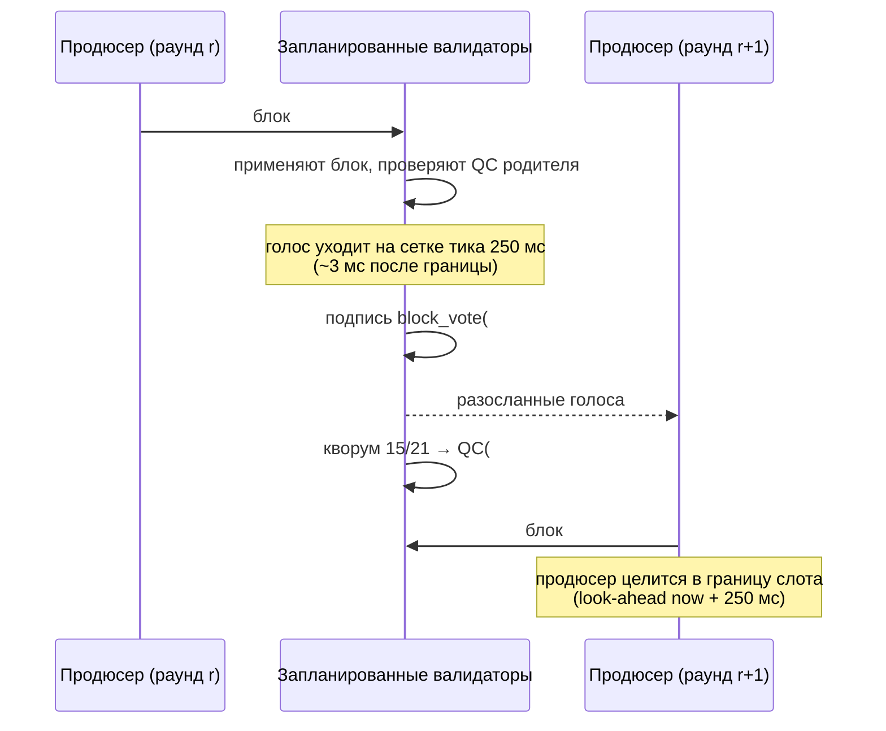
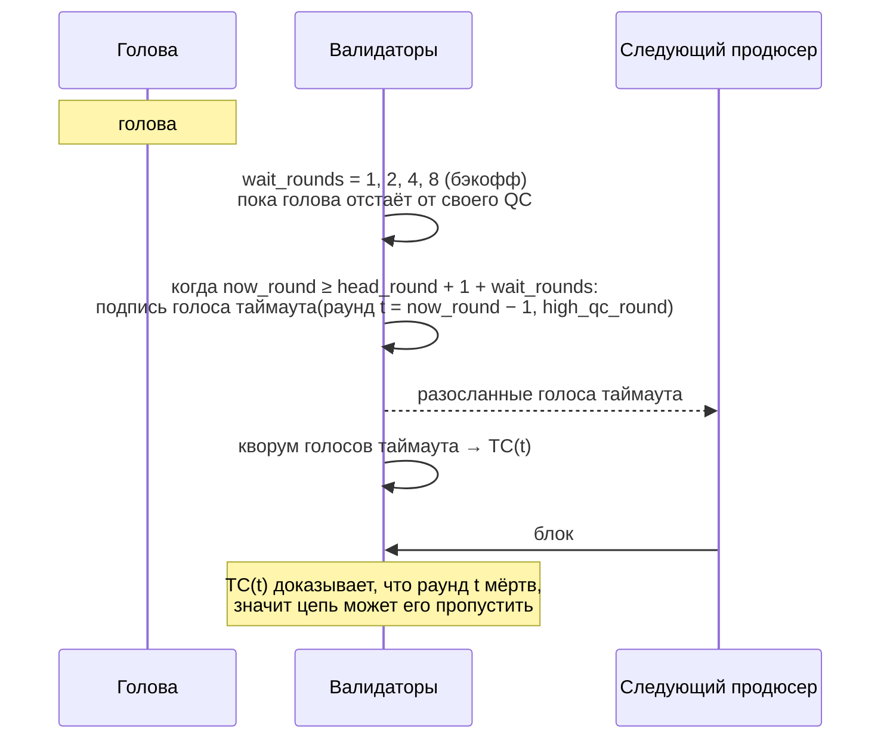

# QC и TC: как блок получает сертификат и как цепь идёт дальше раунда без него

Эта страница рисует консенсус HF16 картиной во времени: что делает продюсер, что делает кворум, что
принимает узел и что происходит, когда кворум не собрался. Она дополняет список правил в
[HF16 / release 4.2.0](./hf16.md): там правила сформулированы, здесь — последовательность.

Всё ниже прочитано по коду, который работает на мейннете после HF16 (`libraries/chain/database.cpp`,
`plugins/validator/validator.cpp`). Где HF18 меняет правило, это отмечено.

## Словарь

| термин | что это в этой реализации |
|---|---|
| **раунд** | **Слот настенного времени**, а не номер блока: `round_of(t) = anchor_round + (t − anchor_time) / block_interval()`. При HF16 слот равен 1 секунде, то есть раунд — это секунда. |
| **QC** | Quorum certificate: подписи кворума запланированных валидаторов над одним блоком. Едет в заголовке ребёнка, тег расширения **3**. |
| **TC** | Timeout certificate: голос кворума за отказ от раунда, в котором QC не появился. Тег **4** (форма HF16) или **6** (форма HF18). |
| **high QC** | Наибольший раунд, на который у валидатора есть QC. Голос таймаута сообщает его, чтобы никто не пропустил уже сертифицированный кем-то блок. |
| **кворум** | `max(floor(2N/3)+1, floor(0.75N))` по запланированным валидаторам — **15 из 21**. |
| **LIB** | Последний необратимый блок, двигается правилом 2-chain (ниже). |

## Нормальный путь: блок, голоса, QC, следующий блок

В этой картине важнее стрелок две вещи:

- **Следующий продюсер продлевает именно QC.** Передача эстафеты несёт QC родителя; блок, у родителя
  которого QC нет, отвергается, если не сработало аварийное разблокирование. Одни голоса ничего вперёд не
  двигают.
- **Голос — один на валидатора на раунд**, и наибольший проголосованный раунд сохраняется до рассылки.
  Повторить тот же голос можно; голос за второй блок в том же раунде — это двойная подпись, доказуемая из
  заголовка (`validator_equivocation`, виртуальная операция 106).

## Путь таймаута: кворум не собрался

Продюсер, не получивший QC текущей головы, произвести не может. Цепь обязана уметь пропустить такую
голову — и делает это голосом таймаута:

Бэкофф нужен, чтобы цепь, идущая медленнее одного блока на слот, всё равно успела собрать кворум до
срабатывания таймаута: ожидание удваивается каждый раз, когда голова отстаёт от собственного high QC.

## Что проверяет узел перед приёмом блока

`database::validate_block_qc` — вся сторона приёмки этого потока. По порядку:

1. **Форма расширений.** Не больше одного QC и одного TC. До HF16 ни то, ни другое не разрешено. После HF18
   форма TC до HF18 отвергается, и наоборот: по сети они не взаимозаменяемы.
2. **QC родителя присутствует**, если не сработало аварийное разблокирование (нет блока
   `CHAIN_EMERGENCY_UNSTICK_TIMEOUT_SEC` времени цепи; читается только из данных цепи, поэтому все узлы
   приходят к одному выводу).
3. **QC сертифицирует родителя или подряд идущего прародителя.** Обычный случай требует
   `cert.block_id == previous` и `cert.round == round_of(head_block_time())` — раунд QC **это слот того
   блока, который он сертифицирует**. Запасной путь late-QC разрешает QC прародителя, но только при трёх
   подряд идущих раундах и только если родитель сам несёт этот QC, так что ничего сертифицированного не
   пропускается.
4. **Кворум и подписи.** 15 из 21, каждая подпись проверяется по дайджесту голоса.
5. **Окно TC.** `cert.round < tc.round < round_of(block.timestamp)` — строго между сертифицированным
   родителем и этим блоком. TC вне окна ничего не доказывает про пропускаемые раунды.
6. **Никто не видел более нового сертифицированного блока.** Каждый голос TC обязан сообщать
   `high_qc_round <= cert.round`. Если бы голосующий видел более высокий QC, пропуск бросил бы
   сертифицированный блок.
7. **Только HF18: голос называет блок.** Голос ровно на `cert.round` обязан называть `cert.block_id`. Без
   этой привязки два блока, сертифицированные в одном раунде, неразличимы, и кворум за один читается как
   кворум за другой.

## Финальность: правило 2-chain

LIB двигается, когда сертифицированный родитель и его сертифицированный ребёнок стоят на локальной главной
ветке на соседних высотах и подряд идущих раундах, а подписанный заголовок ребёнка несёт QC родителя.
Следствия, которые стоит проговорить:

- Ребёнок, использующий **запасной путь late-QC**, не финализирует своего родителя только потому, что
  локальный пул голосов позже собрал QC для обоих.
- **Один изолированный QC недостаточен.** Один сертификат сам по себе ничего не финализирует.

## Таймеры, которые едут на раунде

Два механизма сравнивают раунд головы с текущим, и оба — то, чем цепь переживает застой:

- **Голос таймаута** — `now_round >= head_round + 1 + wait_rounds` (нарисовано выше).
- **Переотправка QC** — когда голова сертифицирована и `now_round >= head_round + 2`, узел заново
  рассылает QC, который держит. Механизм существует потому, что голоса всегда доходили, а QC, который из
  них складывается, — нет: сертифицированная кворумом голова оставалась частным фактом нескольких узлов,
  собравших голоса. Так мейннет простоял 5 ч 20 мин на `#84865875` (01.11.2026).

Оба читают `now_round`, а он — функция **настенного времени**. Любая правка, делающая раунд счётчиком
блоков, обязана сначала дать этим двум механизмам собственную шкалу времени, иначе голову без QC нельзя
будет пропустить, а QC — переотправить.

## Теги расширений (только дописывание)

| тег | структура | с какого форка |
|---|---|---|
| 1 | `version` | унаследовано |
| 2 | `hardfork_version_vote` | унаследовано |
| 3 | `block_qc_certificate` | HF16 |
| 4 | `block_timeout_certificate` | HF16 |
| 5 | `block_equivocation_proof` | HF16 |
| 6 | `block_timeout_certificate_v2` | HF18 |

Индекс и есть формат по сети: новые теги только дописываются, вставка запрещена; расширения транзакций —
отдельный вариант.

## См. также

- [HF16 / release 4.2.0](./hf16.md) — активация, кворум версий и список правил, которые здесь нарисованы.
- [Обработка блоков](./block-processing.md) — где `validate_block_qc` стоит внутри `apply_block`.
- [Разрешение форков](./fork-resolution.md) — что происходит, когда два продюсера строят на одном родителе.
- [Экстренный консенсус](./emergency-consensus.md) — запасной режим, когда раскладка не может собрать кворум.
