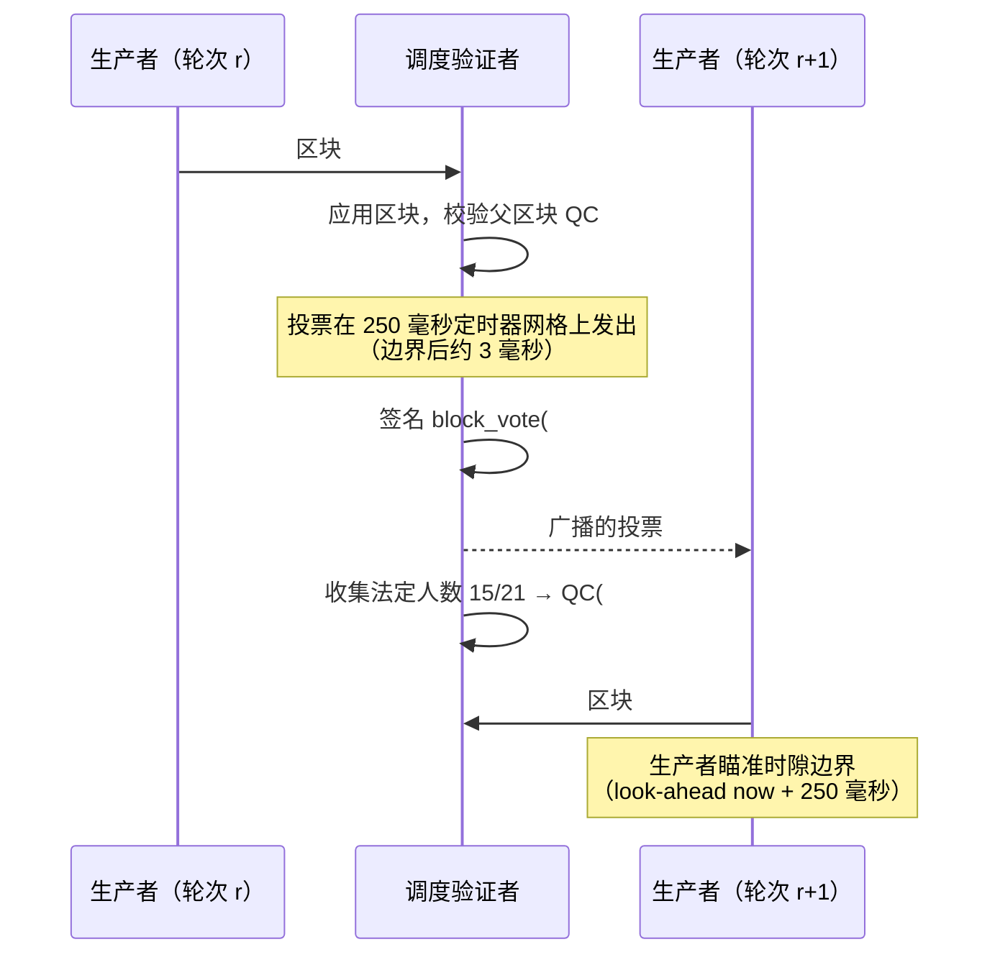
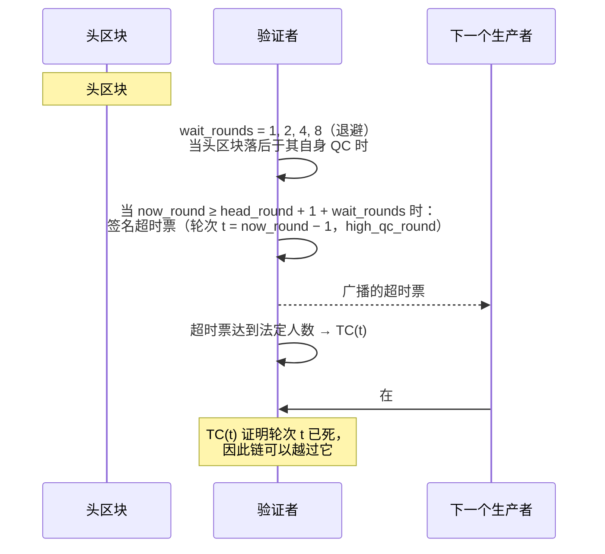

# QC 与 TC：区块如何获得认证，以及链如何越过没有 QC 的轮次

本页用时间图描述 HF16 的共识流程：生产者做什么、法定人数做什么、节点接受什么，以及法定人数未能形成时会发生什么。它补充 [HF16 / release 4.2.0](./hf16.md) 中的规则列表：那里给出规则，这里给出时序。

以下内容均读自 HF16 之后在主网上运行的代码（`libraries/chain/database.cpp`、`plugins/validator/validator.cpp`）。HF18 改变某条规则之处已单独标注。

## 术语

| 术语 | 在本实现中的含义 |
|---|---|
| **轮次 (round)** | **挂钟时间时隙**，不是区块号：`round_of(t) = anchor_round + (t − anchor_time) / block_interval()`。HF16 之后时隙为 1 秒，因此一个轮次就是一秒。 |
| **QC** | 法定人数证书：调度验证者的法定人数对一个区块的签名。随子区块头传输，扩展标签 **3**。 |
| **TC** | 超时证书：法定人数对某个未产生 QC 的轮次表示放弃的投票。扩展标签 **4**（HF16 形式）或 **6**（HF18 形式）。 |
| **high QC** | 验证者持有的最高轮次 QC。超时票会报告它，以免跳过他人已认证的区块。 |
| **法定人数** | 调度验证者上的 `max(floor(2N/3)+1, floor(0.75N))` —— **21 人中 15 人**。 |
| **LIB** | 最后不可逆区块，由 2-chain 规则推进（见下文）。 |

## 正常路径：区块、投票、QC、下一个区块

这张图中比箭头更重要的是两点：

- **下一个生产者延长的是 QC。** 出块权交接携带父区块 QC；父区块没有 QC 的区块会被拒绝，除非紧急解锁生效。仅有投票无法推进。
- **每个验证者每轮只投一票**，最高投票轮次在广播前持久化。允许重复同一票；在同一轮为第二个区块投票属于双重签名，可由区块头证明（`validator_equivocation`，虚拟操作 106）。

## 超时路径：法定人数未能形成

未收到当前头区块 QC 的生产者无法出块。链必须能够跳过该头区块，而它通过超时票做到这一点：

退避的意义在于：运行速度慢于每时隙一个区块的链仍能在超时触发前收集到法定人数——头区块每次进一步落后于自身 high QC，等待时间就翻倍。

## 节点在接受区块前校验什么

`database::validate_block_qc` 就是这一流程的完整接受侧。按顺序：

1. **扩展形状。** 至多一个 QC、至多一个 TC。HF16 之前两者都不允许。HF18 之后，HF16 形式的 TC 被拒绝，反之亦然——二者在网络上不可互换。
2. **父区块 QC 存在**，除非紧急解锁生效（链时间 `CHAIN_EMERGENCY_UNSTICK_TIMEOUT_SEC` 内无区块；只读取链上数据，因此所有节点得出同一结论）。
3. **QC 认证父区块或相邻的祖父区块。** 常规情形要求 `cert.block_id == previous` 且 `cert.round == round_of(head_block_time())` —— QC 的轮次**就是它所认证区块的时隙**。late-QC 备用路径允许祖父区块的 QC，但仅限连续三个轮次，且父区块自身必须携带该 QC，因此不会跳过任何已认证内容。
4. **法定人数与签名。** 21 人中 15 人，每个签名都按投票摘要校验。
5. **TC 窗口。** `cert.round < tc.round < round_of(block.timestamp)` —— 严格位于已认证父区块与本区块之间。窗口之外的 TC 无法证明被跳过的轮次。
6. **无人见过更新的已认证区块。** 每个 TC 票必须报告 `high_qc_round <= cert.round`。若投票者见过更高 QC，跳过就等于放弃已认证区块。
7. **仅 HF18：票要指名区块。** 恰好在 `cert.round` 的票必须指名 `cert.block_id`。缺少这一绑定，同一轮认证的两个区块无法区分，其中一个的法定人数会被读成另一个的。

## 最终性：2-chain 规则

当已认证的父区块与其已认证的子区块位于本地主链、高度相邻且轮次连续，并且已签名的子区块头携带该父区块的 QC 时，LIB 推进。由此有两点值得明确：

- 使用 **late-QC 祖父备用路径**的子区块，不会仅因本地投票池随后收集到两者的 QC 而最终确定其父区块。
- **单个孤立 QC 不足。** 单个证书本身不能最终确定任何东西。

## 依赖轮次的定时器

有两个机制把头区块轮次与当前轮次比较，它们正是链熬过停摆的依靠：

- **超时票** —— `now_round >= head_round + 1 + wait_rounds`（上图）。
- **QC 重播** —— 当头区块已认证且 `now_round >= head_round + 2` 时，节点重新广播其持有的 QC。该机制存在的原因是：投票一直能传播，而由它们汇总成的 QC 却不能；被法定人数认证的头区块只留在收集到投票的少数节点手里。主网因此曾在 `#84865875` 上停摆 5 小时 20 分钟（2026-11-01）。

两者都读取 `now_round`，而它是**挂钟时间**的函数。任何把轮次改为区块计数器的改动，都必须先为这两个机制提供独立的时间基准，否则没有 QC 的头区块永远无法被跳过，QC 也永远无法被重播。

## 扩展标签（只追加）

| 标签 | 结构 | 起始版本 |
|---|---|---|
| 1 | `version` | 继承 |
| 2 | `hardfork_version_vote` | 继承 |
| 3 | `block_qc_certificate` | HF16 |
| 4 | `block_timeout_certificate` | HF16 |
| 5 | `block_equivocation_proof` | HF16 |
| 6 | `block_timeout_certificate_v2` | HF18 |

索引即网络格式：新标签只能追加，不能插入；交易扩展属于另一个 variant。

## 参见

- [HF16 / release 4.2.0](./hf16.md) —— 激活、版本法定人数，以及本页所绘制的规则列表。
- [区块处理](./block-processing.md) —— `validate_block_qc` 在 `apply_block` 中的位置。
- [分叉解决](./fork-resolution.md) —— 两个生产者在同一父区块上构建时会发生什么。
- [紧急共识](./emergency-consensus.md) —— 调度无法形成法定人数时的回退模式。
