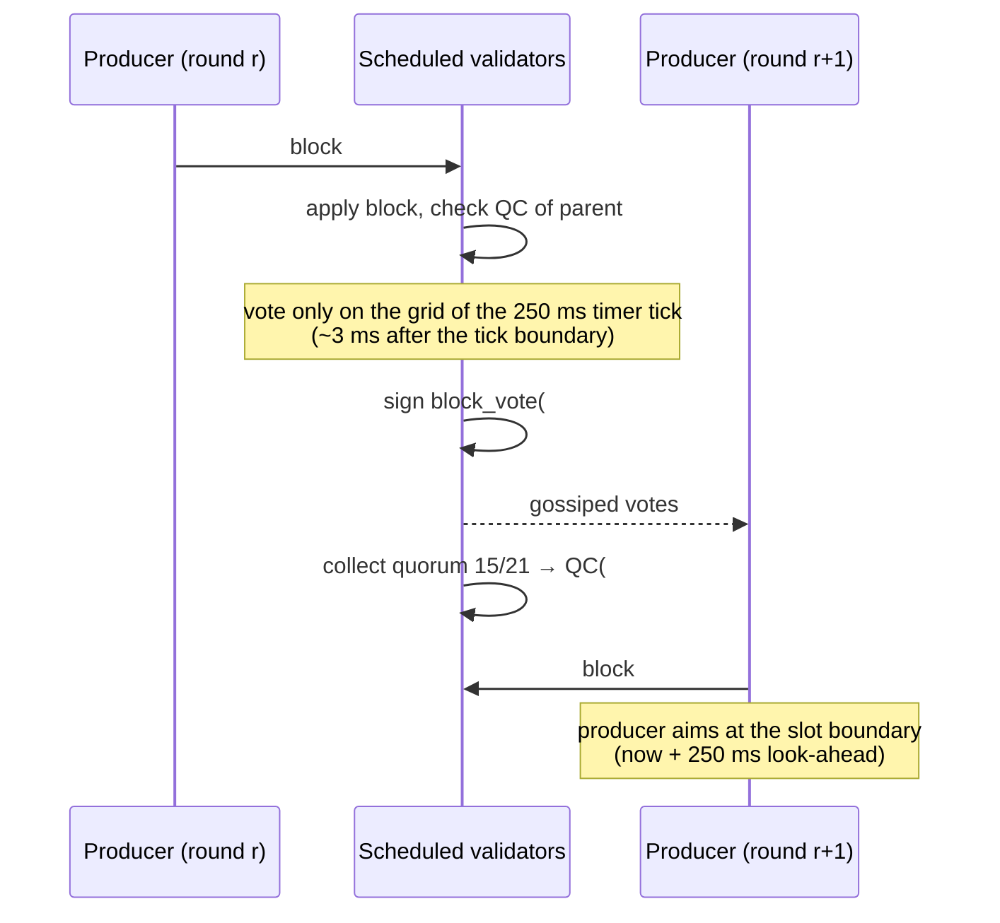
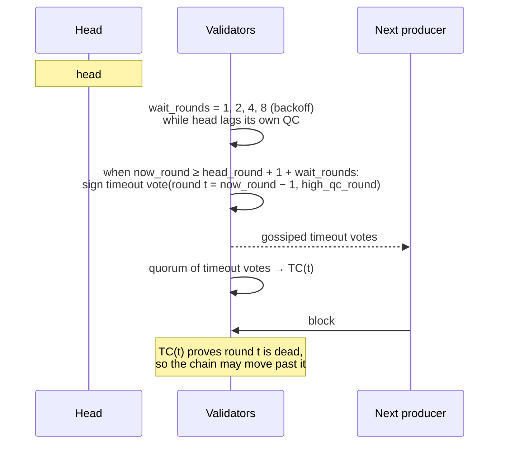

# QC and TC: how a block gets certified, and how the chain moves past a round without one

This page draws the HF16 consensus flow as a picture in time: what a producer does, what a quorum does, what
a node accepts, and what happens when the quorum does not form. It complements the bullet list in
[HF16 / release 4.2.0](./hf16.md) — the rules are stated there, the sequence is drawn here.

Everything below is read from the code that runs on mainnet after HF16 (`libraries/chain/database.cpp`,
`plugins/validator/validator.cpp`). Where HF18 changes a rule, the change is marked.

## Vocabulary

| term | meaning in this implementation |
|---|---|
| **round** | A **slot of wall-clock time**, not a block number: `round_of(t) = anchor_round + (t − anchor_time) / block_interval()`. At HF16 the slot is 1 second, so a round is a second. |
| **QC** | Quorum certificate: signatures of a quorum of scheduled validators over one block. Travels in the child's header, extension tag **3**. |
| **TC** | Timeout certificate: a quorum's vote to give up on a round that produced no QC. Extension tag **4** (HF16 form) or **6** (HF18 form). |
| **high QC** | The highest round a validator holds a QC for. A timeout vote reports it, so nobody skips a block somebody else has already certified. |
| **quorum** | `max(floor(2N/3)+1, floor(0.75N))` over scheduled validators — **15 of 21**. |
| **LIB** | Last irreversible block, advanced by the 2-chain rule (see below). |

## Happy path: block, votes, QC, next block

Two properties of this picture matter more than the arrows:

- **The QC is what the next producer extends.** A producer handover carries the parent QC; a block whose parent
  has no QC is rejected unless emergency unstick applies. Votes alone move nothing forward.
- **Votes are one per validator per round**, and the highest voted round is persisted before broadcasting.
  Repeating the same vote is allowed; voting for a second block in the same round is equivocation and is
  provable from the header (`validator_equivocation`, virtual op 106).

## Timeout path: the quorum does not form

A producer that does not receive a QC for the current head cannot produce. The chain has to be able to skip
that head, and it does so with a timeout vote:

The backoff exists so that a chain running slower than one block per slot still collects a quorum before the
timeout fires: the wait doubles each time the head falls further behind its own high QC.

## What a node checks before accepting a block

`database::validate_block_qc` is the whole acceptance side of this flow. In order:

1. **Extension shape.** At most one QC, at most one TC. Before HF16 neither is allowed. After HF18 the
   pre-HF18 TC form is refused and vice versa — the two are not interchangeable on the wire.
2. **Parent QC is present**, unless emergency unstick applies (no block for
   `CHAIN_EMERGENCY_UNSTICK_TIMEOUT_SEC` of chain time, read only from chain data so every node agrees).
3. **The QC certifies the parent, or a consecutive grandparent.** The normal case requires
   `cert.block_id == previous` and `cert.round == round_of(head_block_time())` — the QC's round *is the slot of
   the block it certifies*. The late-QC fallback allows the grandparent's QC, but only with three consecutive
   rounds and only if the parent itself carries that very QC, so nothing certified is skipped.
4. **Quorum and signatures.** `15 of 21`, and every signature verifies against the vote digest.
5. **The TC window.** `cert.round < tc.round < round_of(block.timestamp)` — strictly between the certified
   parent and this block. A TC outside that window proves nothing about the rounds being skipped.
6. **Nobody saw a newer certified block.** Every TC vote must report `high_qc_round <= cert.round`. If a voter
   had seen a higher QC, skipping would abandon a certified block.
7. **HF18 only: the vote names the block.** A vote at exactly `cert.round` must name `cert.block_id`. Without
   that binding, two blocks certified in the same round are indistinguishable and a quorum for one reads as a
   quorum for the other.

## Finality: the 2-chain rule

LIB advances when a certified parent and its certified child sit on the local main branch at adjacent heights
and consecutive rounds, and the signed child header carries that parent's QC. Consequences worth stating:

- A child that uses the **late-QC grandparent fallback does not finalize its parent** merely because the local
  vote pool later collects QCs for both.
- **One isolated QC is insufficient.** A single certificate never finalizes anything on its own.

## Timers that ride on the round

Two mechanisms compare the head's round with the current one, and both are what makes the chain survive a
stall:

- **Timeout vote** — `now_round >= head_round + 1 + wait_rounds` (drawn above).
- **QC re-gossip** — when the head is certified and `now_round >= head_round + 2`, a node re-broadcasts the QC
  it holds. This exists because votes always travelled but the QC they add up to did not, leaving a head
  certified by a quorum as a private fact of the few nodes that collected the votes; mainnet sat 5 h 20 min on
  `#84865875` (01.11.2026) that way.

Both read `now_round`, which is a function of **wall-clock time**. Any change that makes a round a block
counter has to give these two mechanisms their own time base first, or a head without a QC can never be
skipped and a QC can never be re-gossiped.

## Extension tags (append-only)

| tag | structure | since |
|---|---|---|
| 1 | `version` | legacy |
| 2 | `hardfork_version_vote` | legacy |
| 3 | `block_qc_certificate` | HF16 |
| 4 | `block_timeout_certificate` | HF16 |
| 5 | `block_equivocation_proof` | HF16 |
| 6 | `block_timeout_certificate_v2` | HF18 |

The index is the wire format: new tags are appended, never inserted, and transaction extensions are a separate
variant.

## See also

- [HF16 / release 4.2.0](./hf16.md) — activation, quorum of versions, and the rule list this page draws.
- [Block Processing](./block-processing.md) — where `validate_block_qc` sits in `apply_block`.
- [Fork Resolution](./fork-resolution.md) — what happens when two producers build on the same parent.
- [Emergency Consensus](./emergency-consensus.md) — the fallback when the schedule cannot form a quorum.
